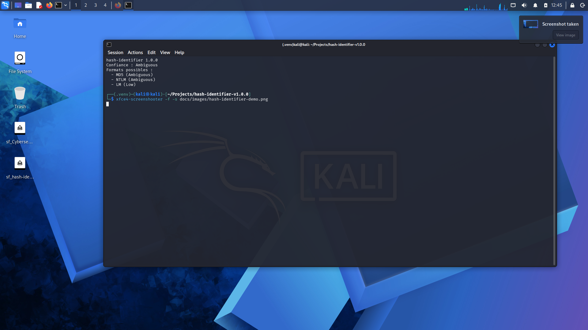

# Hash Identifier v1.0.0

Offline command-line tool that identifies likely hash formats from their
structure. It does **not** crack hashes, recover passwords, or prove which
algorithm generated a value. Some formats overlap, so ambiguous results are
reported as candidates.

## Features

- Raw digest families: MD5, NTLM, SHA-1/224/256/384/512 and SHA-3.
- Password hash formats: bcrypt, Argon2, PBKDF2, scrypt and common `crypt`
  formats.
- MySQL 3.23 and 4.1+, LM, and NetNTLMv1/v2 structural candidates.
- Confidence level and explanation for every result.
- Single and batch analysis, JSON/CSV/TXT exports.
- Local JSON history, search and statistics.
- Python 3.10+, no runtime dependencies.

## Install on Kali Linux / Ubuntu

```bash
sudo apt update
sudo apt install -y python3 python3-venv
python3 -m venv .venv
source .venv/bin/activate
python -m pip install --upgrade pip
python -m pip install .
hash-identifier --help
```

For development and tests:

```bash
python -m pip install -e ".[test]"
pytest --cov=hash_identifier --cov-report=term-missing
```

## Demo



## Examples

```bash
hash-identifier identify 5d41402abc4b2a76b9719d911017c592
hash-identifier identify '$2b$12$.....................................................'
hash-identifier identify --json 5d41402abc4b2a76b9719d911017c592
hash-identifier batch hashes.txt --output results.csv --format csv
hash-identifier history
hash-identifier search sha256
hash-identifier stats
```

You can also run it without installing:

```bash
python run_hash_identifier.py identify 5d41402abc4b2a76b9719d911017c592
```

## Commands

- `identify HASH`: analyse one value.
- `batch FILE`: analyse one hash per line. Blank lines and lines starting
  with `#` are ignored.
- `history`: show saved analyses.
- `search TERM`: search the local history.
- `stats`: show history statistics.
- `export FILE`: export history as JSON, CSV or TXT (format inferred from
  the extension unless `--format` is supplied).
- `delete ID`: delete one history entry.
- `clear`: clear local history after confirmation, or use `--yes`.

Global options include `--version`. `identify` and `batch` support `--json`,
`--verbose`, `--quiet`, and `--no-history`. Batch supports `--output` and
`--format`.

## Detection notes

Identification is structural. For example, a 32-character hexadecimal string
can match both MD5 and NTLM. The tool reports ambiguity rather than guessing.
NetNTLM and LM patterns are heuristic and depend on the source representation.
PBKDF2 and Argon2 parameters are validated for basic syntax and bounds, not
executed. No password verification or cracking is performed.

## Security and privacy

Hashes supplied on the command line may be stored in the local history file
`history.json` in the current working directory. Use `--no-history` to prevent
saving a particular analysis. Do not analyse data you are not authorized to
handle.

## Project layout

```text
src/hash_identifier/
  detector.py   format recognition and confidence
  history.py    local JSON history
  export.py     JSON, CSV and TXT output
  batch.py      file-based batch processing
  main.py       command-line interface
tests/          automated tests
```

## License

MIT. See `LICENSE`.
